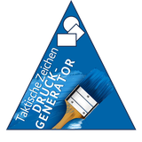
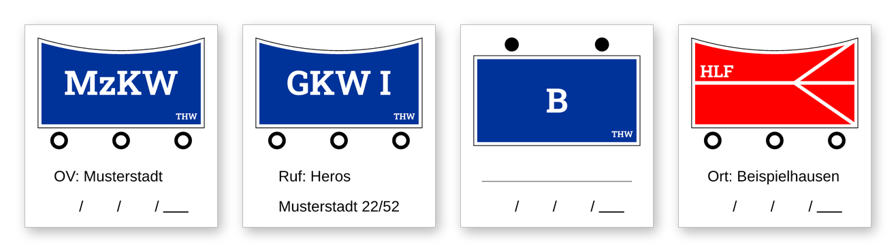
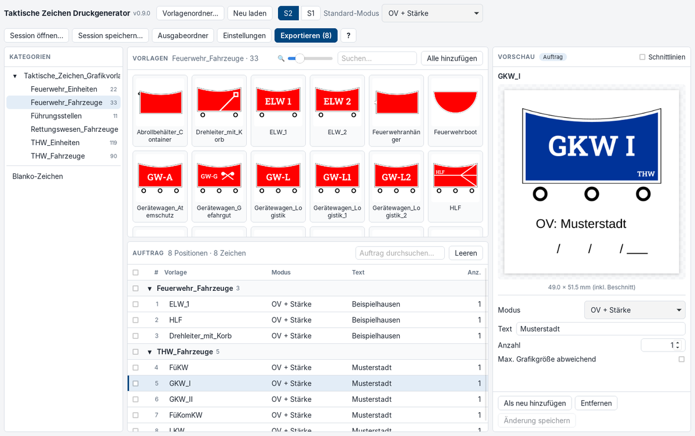
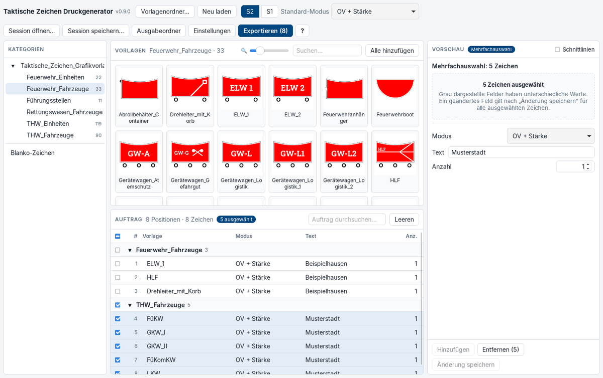
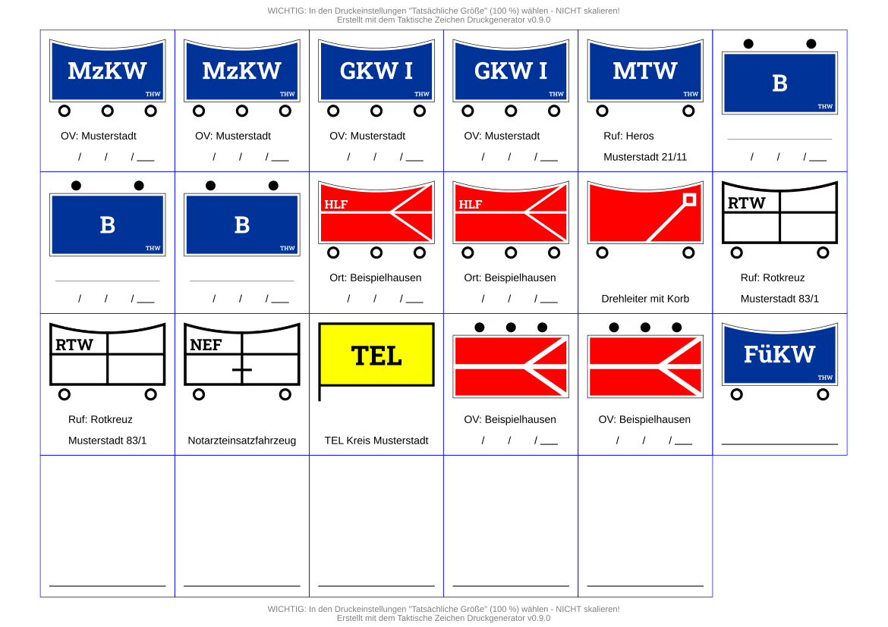
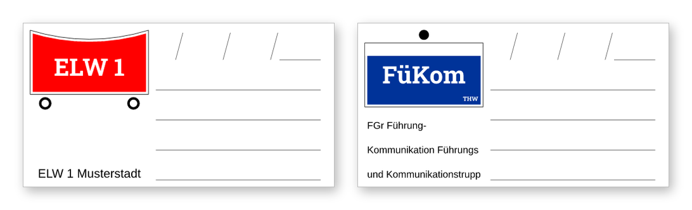
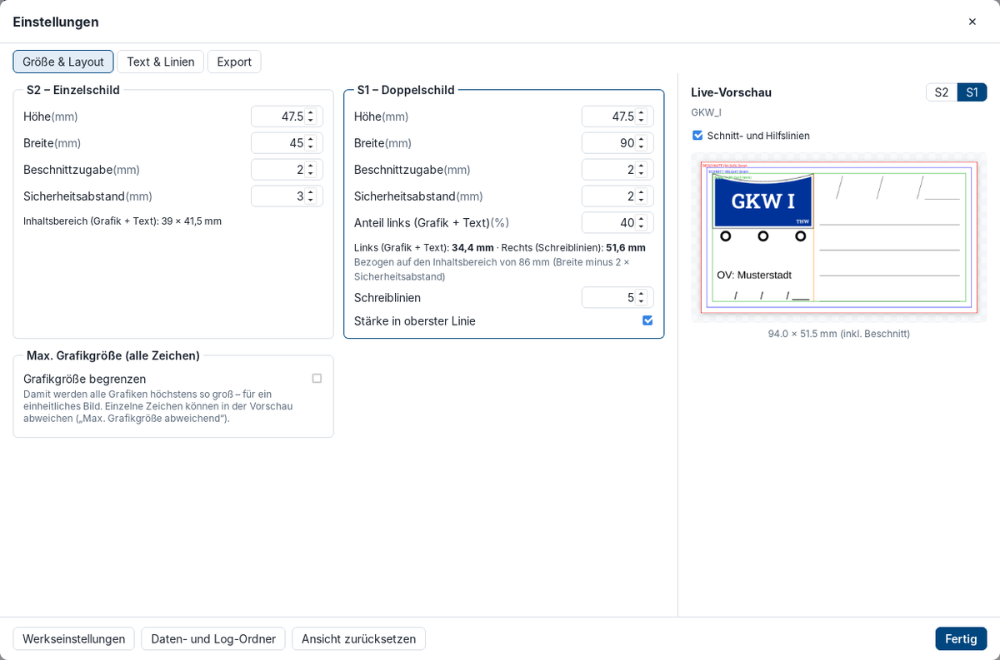

  

<h1 align="center">Taktische Zeichen Druckgenerator</h1>

  
  
  

  Taktische Zeichen beschriften und druckfertig ausgeben – als Einzelzeichen für die Druckerei,
  als Schnittbogen zum Selbstdrucken oder als Bilddatei. 
  Kostenlos und quelloffen für Feuerwehr, THW, Rettungsdienst und alle anderen Hilfsorganisationen.

  

---

## Was ist das?

Der **Taktische Zeichen Druckgenerator** nimmt deine Sammlung taktischer Zeichen (SVG- oder
PNG-Dateien) und macht daraus fertige Schilder für die Lagekarte, die Einsatzleitung oder das
Fahrzeug: mit Beschriftung wie **OV-Name, Ort, Rufname oder Stärkemeldung**, in der gewünschten
Größe, mit Beschnittzugabe für die Druckerei – oder dicht gepackt auf einem A4-Bogen zum Ausschneiden.

Das Programm wurde für die ehrenamtliche und hauptamtliche Arbeit im **Zivil- und
Katastrophenschutz** entwickelt und ist **kostenlos** (GPL v3).

### Das Problem, das wir lösen

**Schluss mit mühsamem Zusammenbasteln in Word-Vorlagen!**

- **Keine Grafikkenntnisse nötig:** Vorlage anklicken, Text eingeben, exportieren
- **Druckerei-gerecht:** Größe, Beschnittzugabe und Sicherheitsabstand werden automatisch eingehalten
- **Stapelverarbeitung:** Dutzende Zeichen in einem Durchgang statt einzeln
- **Ideal für den Einsatzfall:** Vorbereitete PDF-Schnittbögen auf den Einsatz-PCs ablegen und bei
  Bedarf einfach ausdrucken und zuschneiden – vor Ort ist dafür kein Druckgenerator nötig

  

## Was kann es?

**Zeichen auswählen und beschriften**
- Vorlagen-Ordner mit beliebig vielen Kategorien und Unterordnern, Suche und zoombare Vorschaubilder
- Klick auf eine Vorlage zeigt das fertige Zeichen groß in der **Live-Vorschau** – erst „Hinzufügen“
  legt es in den Auftrag
- Sieben Beschriftungs-Modi (siehe unten), Anzahl der Kopien pro Zeichen
- Dasselbe Zeichen mehrfach mit unterschiedlichem Text, z.B. für mehrere Ortsverbände

**Viele Zeichen auf einmal bearbeiten**
- Der Auftrag ist nach Kategorien gruppiert; mit Checkboxen wählst du einzelne Zeichen, ganze
  Kategorien oder alles aus und änderst Modus, Text oder Anzahl für alle gemeinsam
- Probleme werden sofort markiert: Vorlage nicht lesbar, Text zu lang, Schrift fehlt,
  Bildauflösung zu gering

  

**Druckfertig ausgeben**
- **PDF – Einzelzeichen:** eine Seite pro Zeichen mit Beschnittzugabe – so, wie Druckereien es wollen
- **PDF – Schnittbogen:** alle Zeichen in Endgröße auf DIN A4, Hoch- oder Querformat wird
  automatisch gewählt – zum Selbstdrucken und Ausschneiden
- **PNG:** eine Bilddatei pro Zeichen (transparent oder mit weißem Hintergrund), z.B. für Dokumente
- Text und Grafiken bleiben im PDF **gestochen scharf** (Vektorgrafik), auch bei großen Zeichen
- Lange Texte werden automatisch umgebrochen und verkleinert (nie unter 8 pt); reicht der Platz,
  ist eine dritte Zeile möglich – ohne dass die Grafik kleiner wird

  

**Einzel- und Doppelschilder**
- **S2 – Einzelschild:** Grafik oben, zwei Textzeilen darunter (Standard 45 × 47,5 mm)
- **S1 – Doppelschild:** links Grafik und Text, rechts Schreiblinien mit Stärke-Feld zum
  Beschriften mit Folienstift (Standard 90 × 47,5 mm)
- Größe, Ränder, Schrift und Aufteilung frei einstellbar – mit **Live-Vorschau**; die Schriftgröße
  wächst auf Wunsch automatisch mit der Zeichengröße

  

  

### Die Beschriftungs-Modi

| Modus | Ergebnis |
|-------|----------|
| **OV + Stärke** | „OV: Musterstadt“ und darunter die Stärkemeldung `  /   /   / ___` |
| **Ort + Stärke** | „Ort: Beispielhausen“ und Stärkemeldung |
| **Schreiblinie + Stärke** | Linie zum Beschriften und Stärkemeldung |
| **Schreiblinie oder Freitext** | beliebiger Text – oder eine leere Linie zum Beschriften |
| **Ruf** | „Ruf: Heros Musterstadt 22/52“ |
| **Dateiname** | der Name der Vorlagendatei als Text |
| **Nur Grafik** | ohne Text, Grafik oben, mittig oder unten |

Dazu gibt es **Blanko-Zeichen** ohne Grafik, z.B. ein leeres Schild oder ein Doppelschild nur mit
Schreiblinien.

## Download und Start

1. Unter **[Releases](../../releases)**
   die neueste Version herunterladen:
   - **`…_portable.zip`** (empfohlen): entpacken, `TaktischeZeichenDruckgenerator.exe` starten –
     keine Installation, läuft auch vom USB-Stick
   - **`…-setup.exe`** (Installer): nur nötig, wenn das Programm nicht startet, weil auf dem
     Rechner Microsoft WebView2 fehlt – der Installer richtet es mit ein
2. Deine Vorlagen in den Ordner **`Taktische_Zeichen_Grafikvorlagen`** neben der EXE legen
   (jeder Unterordner wird zu einer Kategorie) – oder in der App einen anderen Ordner wählen
3. Beim ersten Start führt dich eine kurze **Einführungstour** durch das Programm; du findest sie
   jederzeit im **?-Menü**

**Systemvoraussetzungen:** Windows 10 oder 11 (64 Bit). Alles Weitere ist enthalten.

## Taktische Zeichen als Vorlagen

Das Programm bringt keine eigenen Zeichen mit – du verwendest deine eigene Sammlung. Eine sehr
umfangreiche, frei nutzbare Sammlung stellt **Jonas Köritz** bereit:
[github.com/jonas-koeritz/Taktische-Zeichen](https://github.com/jonas-koeritz/Taktische-Zeichen)
(die fertigen Zeichen sind gemeinfrei, CC0 1.0). Alle Beispielbilder auf dieser Seite sind damit
erstellt.

> **Tipp:** Die Zeichen dieser Sammlung verwenden die Schrift **Roboto Slab**. Installiere sie
> (kostenlos, z.B. über Google Fonts) oder lege die TTF-Datei in den Ordner `fonts` neben der EXE.
> Fehlt sie, warnt das Programm und verwendet eine Ersatzschrift – Beschriftungen wie „MTW“ wirken
> dann größer als vorgesehen.

Unterstützt werden **SVG**, **PNG** und **JPG**. Für den Druck sind SVG-Vorlagen ideal; bei
PNG/JPG meldet das Programm, wenn die Auflösung für die gewählte Größe zu gering ist.

## Häufige Fragen

**Wird ein weißer Hintergrund mitgedruckt?**
Nein. Das PDF hat keinen Hintergrund – auf farbigem Material bleibt der Untergrund sichtbar. Nur
weiße Flächen, die in der Vorlage selbst enthalten sind, werden als Teil der Grafik gedruckt (im
normalen Druck heißt Weiß „keine Farbe“).

**Wie drucke ich den Schnittbogen richtig?**
Im Druckdialog **„Tatsächliche Größe“ (100 %)** wählen, nicht „An Seite anpassen“ – sonst stimmen
die Maße nicht. Der Hinweis steht auch auf jedem Bogen.

**Wo finde ich meine Exporte?**
Über den Knopf **„Ausgabeordner“**. Jeder Export liegt in einem eigenen Unterordner mit Datum und
Uhrzeit. Gab es Hinweise (z.B. zu lange Texte), liegt dort zusätzlich eine `Hinweise.txt`.

**Windows warnt beim ersten Start („Der Computer wurde durch Windows geschützt“)?**
Das Programm ist nicht digital signiert (das kostet Geld). Über „Weitere Informationen“ →
„Trotzdem ausführen“ lässt es sich starten.

## Lizenz und Kontakt

Der Taktische Zeichen Druckgenerator ist freie Software unter der
**[GNU General Public License v3](LICENSE)** – kostenlos für alle Zwecke, auch kommerziell. Die
Lizenzen der verwendeten Komponenten liegen dem Programm bei
([Übersicht](THIRD-PARTY-LICENSES.md)).

Fehler und Wünsche bitte als [Issue](../../issues)
melden. Falls du das Programm kommerziell einsetzt, freuen wir uns über eine kurze Mitteilung
(keine Pflicht): Ramon-Hoffmann@gmx.de

Informationen für Entwickler: **[ENTWICKLUNG.md](ENTWICKLUNG.md)**
